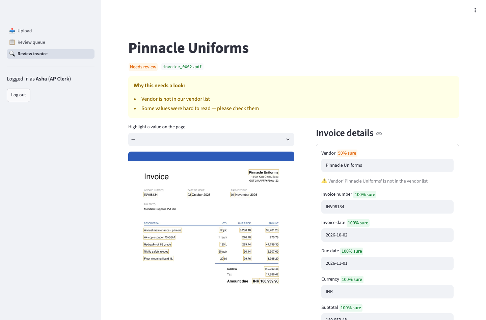

# Invoice Intake — AI for Accounts Payable

Reads supplier invoices (PDFs, scans, phone photos) with OCR + an LLM (Google Gemini by default, Anthropic Claude optional), checks them against business rules and for duplicates, auto-approves the ones it is sure about, and sends the rest to a review screen where a clerk can see exactly where each value came from on the page. Built for the fictional distributor Meridian Supplies.



## Run it locally (about 10 minutes)

**First-time setup, step by step from `git clone` (Docker, secrets, database, login): [docs/local_setup.md](docs/local_setup.md).** Day-to-day use and troubleshooting: [docs/setup_guide.md](docs/setup_guide.md). The short version:

You need **Docker Desktop** and **git**. A Gemini API key is needed only for reading real invoices (free at aistudio.google.com/apikey).

```bash
git clone https://github.com/diiyark123/invoice-intake.git && cd invoice-intake
cp .env.example .env                      # Windows: Copy-Item .env.example .env
# edit .env: paste your GEMINI_API_KEY, and set SESSION_SECRET to the output of
#   python -c "import secrets; print(secrets.token_urlsafe(48))"
docker compose up -d --build              # first build takes ~5 minutes
docker compose exec api python -m app.seed
```

Open **http://localhost:8501** and log in:

| Role | Email | Password |
|---|---|---|
| AP clerk | `clerk@meridian.test` | `clerk-demo-123` |
| AP manager | `manager@meridian.test` | `manager-demo-123` |

These demo passwords are for local use only; production refuses to start with them.
Try it: upload a file from `data/dev/` on the **Upload** page. API docs: http://localhost:8000/docs.

> If port 8000 or 5432 is already used by something else on your machine, change the left-hand port in `docker-compose.yml` (e.g. `"8001:8000"`).

## Everyday commands

```bash
docker compose exec api pytest -q                      # tests (no real AI calls)
docker compose exec api python -m data.generator.generate --count 20 --out data/dev --scan 0.5
docker compose exec api python -m eval.run_eval        # evaluation on the held-out test set (uses Gemini)
docker compose logs -f api                             # watch processing logs
```

## Documentation

| Document | For |
|---|---|
| [docs/local_setup.md](docs/local_setup.md) | First-time setup from `git clone`: Docker, secrets in `.env`, database and login users, first invoice |
| [docs/setup_guide.md](docs/setup_guide.md) | Day-to-day: starting, stopping, updating, where data lives, every `.env` setting, commands, troubleshooting |
| [docs/clerk_guide.md](docs/clerk_guide.md) | AP clerks: uploading and reviewing invoices (1 page) |
| [docs/admin_runbook.md](docs/admin_runbook.md) | Deploying to Render + Cloudflare R2, keys, backups, troubleshooting |
| [docs/architecture.md](docs/architecture.md) | How it works, with diagrams and design trade-offs |
| [docs/how_it_fits_together.md](docs/how_it_fits_together.md) | Login tokens explained, and one invoice traced file by file from Docker to the database |
| [docs/evaluation_report.md](docs/evaluation_report.md) | Accuracy, automation rate, duplicates, cost — before and after tuning |
| [PROJECT_SPEC.md](PROJECT_SPEC.md) | The full specification |
| [docs/BUILD_PLAYBOOK.md](docs/BUILD_PLAYBOOK.md) | Build steps and decisions D1–D24 |
| [PROGRESS.md](PROGRESS.md) | Milestone status and open items |

## Results so far (synthetic invoices only)

100% of fields read correctly · 64% auto-approved with 0 wrong values · 5/5 seeded duplicates caught · 4.4 s per invoice · ~$3.30/month in AI cost for 2,000 invoices. Real-world samples are not in the test set yet — see the [evaluation report](docs/evaluation_report.md).

## Tech

Python 3.11 · FastAPI · SQLAlchemy + Alembic · PostgreSQL · Streamlit · PyMuPDF · OpenCV · Tesseract · Gemini / Claude · Docker · Render · Cloudflare R2
