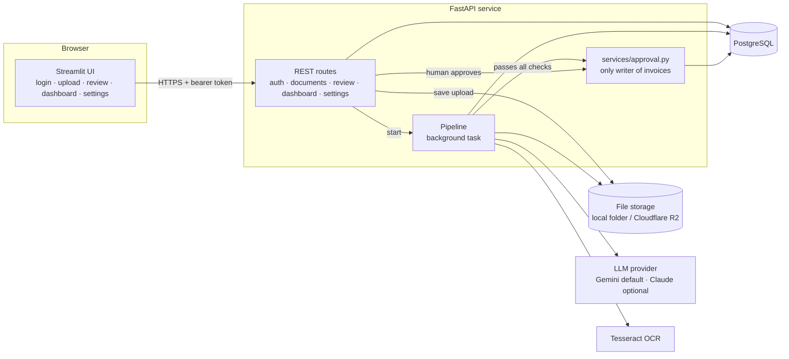
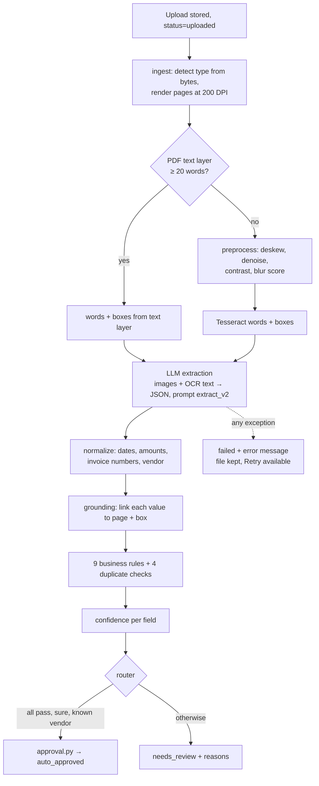

# Architecture

Invoice Intake turns supplier invoices (PDFs, scans, phone photos) into approved records for Meridian Supplies' accounts payable team. Invoices that pass every check are approved automatically; the rest go to a person with the reasons listed.

## Components

## Processing pipeline (one background task per document)

## Data

| Table | Holds | Written by |
|---|---|---|
| `documents` | One row per upload: file key, sha256, status, review reasons, error | API, pipeline |
| `extractions` | One row per processing run: model, prompt version, raw LLM JSON, rule results, duplicate link, tokens, cost | pipeline |
| `extracted_fields` | Every value: raw + normalized, page, box, source OCR text, match score, confidence | pipeline, review edits |
| `invoices`, `invoice_line_items` | Final approved records (money as NUMERIC(14,2)) | **only** `services/approval.py` |
| `vendors`, `settings`, `users` | Reference data and tunable rules | seed, manager settings |
| `audit_log` | Every human edit, approval, rejection, retry, settings and vendor change | services |

## Design rules (spec §2) and how they are enforced

| Rule | Enforcement |
|---|---|
| No unvalidated writes | `approval.py` re-runs every check itself; a test scans `app/` and fails if invoices are created anywhere else |
| Traceability | Each field stores page, box, OCR text; each extraction stores model + prompt version; edits go to `audit_log` |
| Never lose an upload | The file is stored before anything else; any exception sets `failed` and keeps the file; Retry creates a new extraction |
| Secrets in env vars | `.env` locally (git-ignored), Render environment in production |
| Money as Decimal | `Decimal` in Python, `NUMERIC(14,2)` in Postgres, never float |

## Key design choices and trade-offs

| Choice | Why | Trade-off |
|---|---|---|
| OCR **and** the LLM | OCR gives word positions (for boxes and grounding); the LLM gives understanding | Two systems to run; scans need Tesseract in the image |
| Confidence from *grounding*, not the model's own opinion | Explainable: "found on the page, parses, no failed rule" | A value both OCR and the model misread the same way scores high — mitigated by prompt v2 ("trust the image") |
| Only header fields decide auto-approval (spec §10) | Simple and matches the spec | A line-item description typo can slip through (seen once in the M3 baseline) |
| Gemini Flash-Lite by default, Claude behind the same interface | Cheapest model that reached 100% field accuracy on dev; switch with one env var | Free tier is 15 requests/min — the provider waits and retries |
| FastAPI background tasks, no queue | Enough for ~2,000 invoices/month | A restart mid-processing leaves a document in `processing`; Retry is manual |
| Streamlit UI | Fast to build, Python only | Less control over layout than a custom front end |

Decisions that fill gaps in the spec are numbered D1–D24 in `docs/BUILD_PLAYBOOK.md`.
