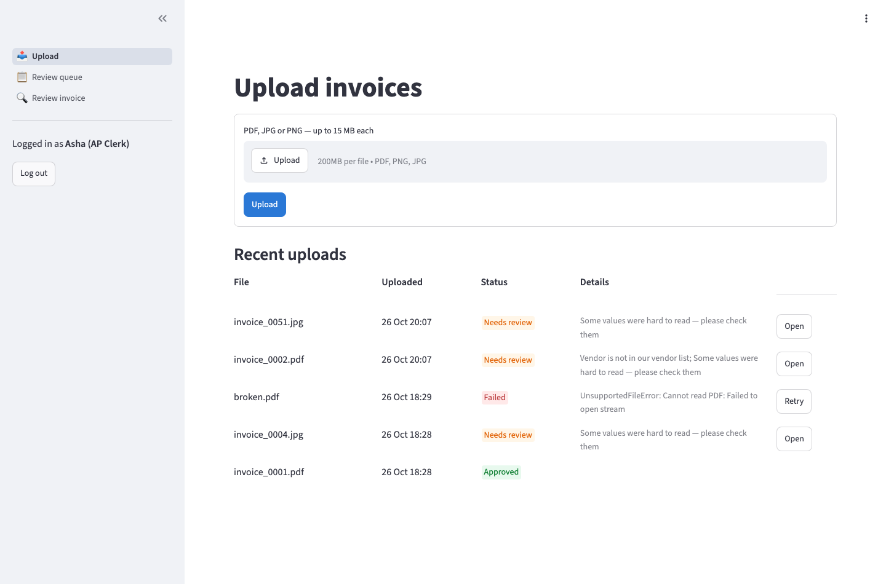
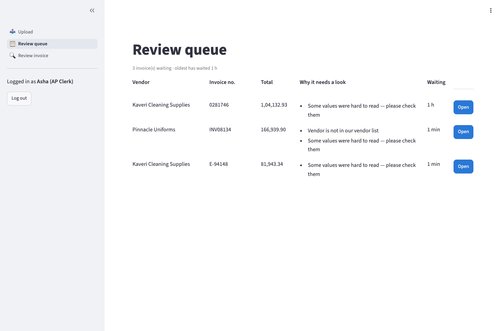
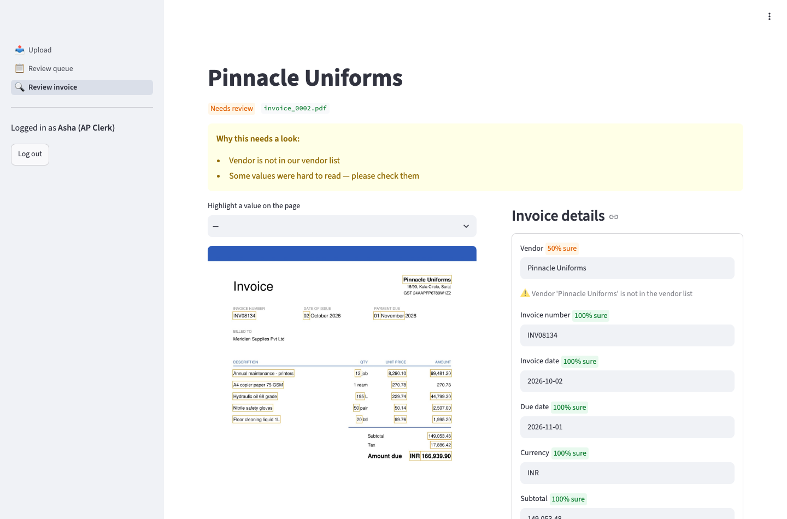

# Clerk guide — checking invoices in Invoice Intake

**What the app does for you:** it reads each supplier invoice, fills in the details, and checks them. Invoices it is sure about are approved automatically. You only see the ones that need a person.

## 1. Log in
Open the link your manager gave you and log in with your email and password.

## 2. Upload invoices
**Upload** → drag PDFs or photos (JPG/PNG, up to 15 MB each) into the box → **Upload**.
The list below updates by itself. Status colours:

| Colour | Meaning | What you do |
|---|---|---|
| 🟢 Approved / Approved (automatic) | Saved as an approved invoice | Nothing |
| 🟠 Needs review | The app wants a person to check it | Click **Open** |
| 🔴 Failed | The file couldn't be read (e.g. damaged, or the AI service was busy) | Click **Retry**. If it fails again, tell your manager |

## 3. Work through the review queue
**Review queue** lists invoices waiting for you, oldest first, with the reason in plain words. Click **Open**.

## 4. Check and fix an invoice
- **Left:** the invoice page. Orange boxes show where each value was read. Pick a value in *Highlight a value on the page* to see it in blue.
- **Right:** the values. Each has a badge: 🟢 green = the app is sure, 🟠 amber or 🔴 red = please look closely. A ⚠️ line under a value explains a problem (for example *"Subtotal + tax doesn't equal total"*).
- Correct any wrong value by typing over it. Line items can be edited, added (empty row at the bottom) or deleted.

Then click one of:

| Button | When |
|---|---|
| **Save and approve** | Everything matches the paper invoice |
| **Save changes** | You fixed something but want to look again (the checks re-run immediately) |
| **Reject this invoice** | It isn't ours, is a copy, or can't be paid. A reason is required |

**If approval is refused**, the app lists what is still wrong — fix those values and try again.
**Possible duplicate:** the earlier invoice is shown underneath for comparison. Approve only if you are sure it is a separate invoice, and write why in **Note**. An invoice number already booked for the same vendor can never be approved twice.
**New vendor:** approving adds the vendor to the vendor list automatically.

Everything you change is recorded with your name and the time.
