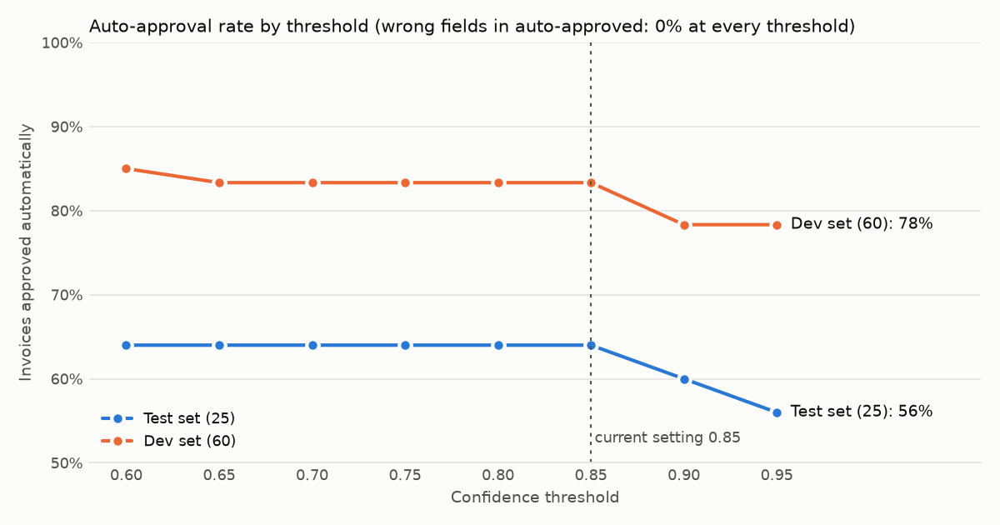

# Evaluation report — AI invoice intake

**Bottom line:** on synthetic invoices the system reads every field correctly, auto-approves 64% of invoices with zero wrong values among them, and catches all seeded duplicates, at about **$3.28 a month** in AI cost for 2,000 invoices. It misses the 70% auto-approval target, but the test set's design caps the achievable rate at 68%. **None of this has been measured on real supplier invoices yet** — that is the main gap before go-live.

## What was measured

| | |
|---|---|
| Test set | 25 invoices, held out and never used for tuning: 20 originals in 5 layouts (8 rendered as noisy scans), 5 seeded duplicates of 5 different kinds, 3 vendors deliberately missing from the vendor list |
| Not yet included | ~15 real public-dataset invoices and ~10 phone photos (spec §13 asks for 50 in total) |
| Tuning set | 60 separate synthetic invoices (`data/dev`), half scanned, 10% unknown vendors |
| Model | Google `gemini-3.5-flash-lite`, confidence threshold 0.85 |
| "Correct" | normalized value equals the label (amounts exact to 2 dp, dates as ISO, text case-insensitive) |

## Results: before and after improvements

| Metric | Target | Baseline (M3) | After M5 | Met? |
|---|---|---|---|---|
| Field-level accuracy | ≥ 90% | 99.8% | **100%** | ✅ |
| Auto-approved, no human edits | ≥ 70% | 60% | **64%** | ❌ (ceiling 68%, see below) |
| Wrong fields among auto-approved | ≤ 1% | 0.26% | **0%** | ✅ |
| Seeded duplicates caught | 5 / 5 | 5 / 5 | **5 / 5**, no false alarms | ✅ |
| Handling time, auto-approved | < 1 min | 8.0 s | **4.4 s** | ✅ |
| Handling time, reviewed | < 2 min | — | **not measured yet** | ⏳ |
| AI cost per invoice | report | $0.0016 | **$0.00164** | — |

**Why auto-approval stops at 64%.** 8 of the 25 test invoices *should* go to a person — the 5 duplicates and 3 unknown vendors — so 68% is the most any system could auto-approve on this set. Of the 17 invoices that were eligible, **16 (94%)** were approved automatically. The target needs re-checking on a realistic mix of documents.

Raw results: `eval/results/20261026T184928Z.json` (baseline), `eval/results/20261026T195148Z.json` (after).

## What improved, and why

All changes were found and checked on the 60 dev invoices, never on the test set.

| Change | Problem it fixed |
|---|---|
| New prompt (`extract_v2`): treat the image as the truth, the OCR text only as a hint | The model copied an OCR misreading (`INVO6061` for `INV06061`) and the invoice was auto-approved with a wrong number |
| Dates and amounts matched against how they are printed | A blurry date was matched to an invoice number, giving a misleading score |
| OCR punctuation slips tolerated for currency (`Rs,`) | A clean invoice went to review only because of a comma |
| Blur warning threshold lowered (100 → 40) | 4 perfectly readable scans were flagged as blurry |
| Automatic retry when Gemini is busy | The free tier's 15 requests/minute caused a failure during a burst |

On the dev set these took auto-approval from 75% to 83% and wrong fields in auto-approved invoices from 0.09% to 0%.

## Choosing the threshold

| Threshold | 0.60 | 0.65 | 0.70 | 0.75 | 0.80 | 0.85 | 0.90 | 0.95 |
|---|---|---|---|---|---|---|---|---|
| Auto-approved (test) | 64% | 64% | 64% | 64% | 64% | 64% | 60% | 56% |
| Auto-approved (dev) | 85% | 83% | 83% | 83% | 83% | 83% | 78% | 78% |
| Wrong fields in auto-approved | 0% | 0% | 0% | 0% | 0% | 0% | 0% | 0% |

Lowering the threshold below 0.85 approves almost nothing extra; raising it only sends more correct invoices to people. **Recommendation: keep 0.85** and revisit once real invoices are in the test set, where errors are more likely.

## Cost

| | |
|---|---|
| Tokens per invoice | ~2,050 in, ~385 out |
| Price (paid tier, 2026-10-26) | $0.30 per million input tokens, $2.50 per million output tokens |
| Cost per invoice | **$0.0016** |
| 2,000 invoices / month | **≈ $3.30 / month** |
| Hosting | $0 on free plans (demo only); paid Render database + services needed for real use |

## Manual-entry baseline

**Not measured yet.** To complete this section, time 10 invoices typed by hand into the current process (stopwatch from opening the PDF to saving the entry) and record the average here: _____ min per invoice. Compare it with 4.4 s for auto-approved invoices and the (also pending) timed review of a flagged invoice.

## Design trade-offs

| Decision | Benefit | Cost / risk |
|---|---|---|
| OCR + LLM together | Word positions for the review screen, plus the model's understanding | Two components; OCR errors can mislead the model (mitigated by prompt v2) |
| Confidence = "found on the page × parses × no broken rule" | Easy to explain to auditors | A value that OCR and the model misread identically still scores high |
| Only header fields decide auto-approval (spec §10) | Simple, matches the spec | A wrong line-item description could slip through (seen once in the baseline) |
| Cheapest Gemini model | ~$3/month at full volume | Free tier rate limits; may need a stronger model for messy real photos |
| Duplicates never auto-approved; same vendor + number can never be booked twice | No double payments | Legitimate re-issues need a note from a person |

## Next steps

1. **Add the real-world samples** (15 public invoices, 10 phone photos) and re-run both evaluations — the most important gap.
2. **Time the manual baseline and a flagged-invoice review** to complete the handling-time targets.
3. Consider letting line-item confidence count toward auto-approval (a spec change) if real data shows description errors.
4. Re-tune the blur threshold on real phone photos.
5. Tidy the review reasons: duplicates currently also show "hard to read" because the spec's formula lowers confidence for fields in a failed rule.
6. Move to paid hosting and a paid Gemini tier before real use (database expiry, rate limits).
