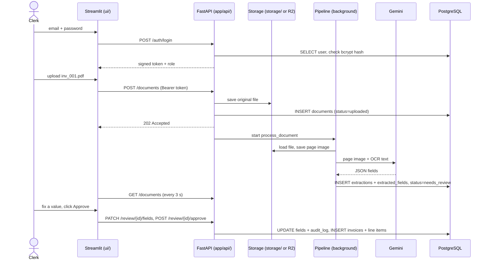

# How the pieces fit together

A walkthrough for anyone new to the code: how login works, and what happens, file by file, when one invoice goes from Docker start-up to an approved record. For the design view, see [architecture.md](architecture.md).

## Part 1 — Login, tokens and `SESSION_SECRET`

### The three things involved

| Thing | Lives where | Changes? | Purpose |
|---|---|---|---|
| `SESSION_SECRET` | API's environment (`.env` locally, Render env var in production) | **No** — fixed, set once | The key used to *sign* login tokens so nobody can forge one |
| Token | Inside `st.session_state.api` in the Streamlit app | **New one at every login** | Proof that "this user already logged in correctly"; sent with every request |
| `st.session_state` | Streamlit server memory, one per browser tab | Cleared on logout / tab close | Remembers the token and the user's role between clicks |

### Why Streamlit needs `st.session_state`

Streamlit re-runs the whole page script **on every click**. Ordinary variables are reset each time, so without `session_state` you would be logged out after every click. `session_state` is a small dictionary Streamlit keeps alive between re-runs for that browser tab. This app keeps two things in it ([ui/common.py](../ui/common.py), [ui/Home.py](../ui/Home.py)):

- `api` — the `ApiClient`, which holds the login token
- `user` — `{"role": ..., "name": ...}`, used to decide which pages to show

### What a token looks like

```
eyJ1aWQiOiIxMjM0Iiwicm9sZSI6ImNsZXJrIn0 . auH_2Q . fbIzFAU1j2XIZX3VlNGpVHIYzRU
            part 1: data                 part 2: time   part 3: signature
```

| Part | Contents | Readable by anyone? |
|---|---|---|
| Data | `{"uid": "1234", "role": "clerk"}` (only encoded, not encrypted) | Yes |
| Time | When the token was made — used for the 8-hour expiry | Yes |
| Signature | `scramble(data + time + SESSION_SECRET)` | Only the server can **make** it |

The scramble is one-way: you cannot get the secret back from a signature, and you cannot produce a correct signature without the secret.

### How it is used ([app/auth.py](../app/auth.py))

1. **Login** — `POST /auth/login` checks the email and password against the `users` table (bcrypt hash). Only if they match does `create_token()` build the data and sign it with `SESSION_SECRET`.
2. **Every later request** — the token is sent as `Authorization: Bearer <token>`. `read_token()` re-signs the token's own data with `SESSION_SECRET` and compares the result to the signature *inside the token*, then checks the age. If both pass, the API trusts the user id and role without asking the database.

The server stores **no tokens and no signatures** — not in `.env`, not in the database. Each signature travels inside its own token.

### One secret, many users

| | Clerk logs in | Manager logs in |
|---|---|---|
| Password checked against DB | ✅ | ✅ |
| Token data | `uid=111, role=clerk` | `uid=222, role=manager` |
| Signed with | same `SESSION_SECRET` | same `SESSION_SECRET` |
| Signature | `fbIz…` | `Q9xk…` (different, because the data differs) |
| Later requests | re-sign → `fbIz…` → matches ✅ | re-sign → `Q9xk…` → matches ✅ |

Both users are logged in at the same time. Who may log in at all is decided by the **password check**, not by the secret.

### What gets rejected

| Situation | Why it fails |
|---|---|
| Someone edits a token (`clerk` → `manager`) | Re-signing the edited data gives a different signature from the one in the token |
| Someone invents a token | They don't know the secret, so they can't compute the signature |
| Token older than 8 hours | Age check fails → "Session expired" |
| Admin changes `SESSION_SECRET` | Every old token was signed with the old secret → everyone is logged out |

**Analogy:** the token is a concert wristband with your name printed on it; `SESSION_SECRET` is the organiser's stamp. Anyone can read the name, but the guard only lets you in if the stamp is real — and only the organiser has the stamp. That is why the secret must never change by itself and must never leak.

## Part 2 — One invoice, end to end

**Example:** a clerk logs in, uploads `inv_001.pdf`, it is processed, lands in review, the clerk fixes one value and approves it.



### Step 0 — `docker compose up -d --build`

| What | File | Result |
|---|---|---|
| Build one image: Python 3.11 + Tesseract + all packages | [Dockerfile](../Dockerfile) | Same image is used for both the API and the UI |
| Start 3 containers | [docker-compose.yml](../docker-compose.yml) | `db` (Postgres 16, port 5432, data kept in the `pgdata` volume), `api` (port 8000), `ui` (port 8501) |
| Give settings to `api` and `ui` | `.env` via `env_file: .env` | Keys, `DATABASE_URL`, `SESSION_SECRET`, `API_BASE_URL` become environment variables |
| Containers find each other by service name | `.env` | API → `postgresql+psycopg://…@db:5432/invoice`; UI → `API_BASE_URL=http://api:8000` |
| Your project folder is mounted at `/app` | `volumes: - .:/app` | Code edits apply live; `./storage/` on your Mac holds the uploaded files |

Then `docker compose exec api python -m app.seed` ([app/seed.py](../app/seed.py)) inserts the clerk and manager users (bcrypt-hashed passwords) and the vendor list.

### Step 1 — The API starts

`api` runs `alembic upgrade head` (tables up to date), then `uvicorn app.main:app`.

| Order | File | What it does |
|---|---|---|
| 1 | [app/config.py](../app/config.py) | `get_settings()` reads the environment once (cached) into a `Settings` object |
| 2 | [app/db.py](../app/db.py) | Creates the database `engine` and `SessionLocal` (a factory for DB sessions) |
| 3 | [app/main.py](../app/main.py) | `create_app()` registers the routers: `auth`, `documents`, `review`, `dashboard`, `settings` |
| 4 | [app/main.py](../app/main.py) `lifespan` | `recover_interrupted()` marks any document left mid-way by a restart as `failed` |

### Step 2 — The clerk opens http://localhost:8501

`ui` runs `streamlit run ui/Home.py`. [ui/Home.py](../ui/Home.py) calls `current_user()` ([ui/common.py](../ui/common.py)); `session_state` is empty, so it shows the login form.

### Step 3 — Login

| # | Where | What happens |
|---|---|---|
| 1 | [ui/Home.py](../ui/Home.py) `login_page` | Clerk submits the form → `client().login(email, password)` |
| 2 | [ui/common.py](../ui/common.py) `client()` | Creates one `ApiClient` and keeps it in `st.session_state.api` |
| 3 | [ui/api_client.py](../ui/api_client.py) | `POST http://api:8000/auth/login` with JSON `{email, password}` |
| 4 | [app/api/auth.py](../app/api/auth.py) `login` | `get_session()` opens a DB session; `SELECT … FROM users WHERE email = …` |
| 5 | [app/auth.py](../app/auth.py) | `verify_password()` (bcrypt) → `create_token()` signs `{uid, role}` with `SESSION_SECRET` |
| 6 | back in the UI | `ApiClient` stores the token; `st.session_state.user = {role, name}`; `st.rerun()` |
| 7 | [ui/Home.py](../ui/Home.py) | Now logged in → builds the page menu by role (managers also get Dashboard and Settings) |

From here on, **every** call from the UI carries `Authorization: Bearer <token>`, and every API route checks it with `require_user` (or `require_manager`) from [app/auth.py](../app/auth.py).

### Step 4 — Upload

| # | Where | What happens |
|---|---|---|
| 1 | [ui/pages/1_Upload.py](../ui/pages/1_Upload.py) | Clerk picks `inv_001.pdf` → `client().upload(...)` |
| 2 | [ui/api_client.py](../ui/api_client.py) | `POST /documents` (multipart file + Bearer token) |
| 3 | [app/auth.py](../app/auth.py) `require_user` | Verifies the token → `CurrentUser(id, role="clerk")` |
| 4 | [app/api/documents.py](../app/api/documents.py) `upload_documents` | Checks size (≤ 15 MB) and real file type (`detect_type`, from the bytes) |
| 5 | [app/storage.py](../app/storage.py) `save` | **File saved first**: `storage/<doc-id>/original/inv_001.pdf` (local) or the same key in the R2 bucket (production) |
| 6 | same route | `INSERT INTO documents (… status='uploaded', sha256, uploaded_by)` → commit |
| 7 | same route | `background.add_task(process_document, doc_id)` → replies **202 Accepted** at once |

### Step 5 — Processing in the background

[app/pipeline/orchestrator.py](../app/pipeline/orchestrator.py) `process_document` opens **its own** DB session (the request's session is already closed).

| # | Step | File | Storage / DB effect |
|---|---|---|---|
| 1 | Mark started | orchestrator | `documents.status = 'processing'` |
| 2 | Load + split into pages | [ingest.py](../app/pipeline/ingest.py) | `storage.load(original)` |
| 3 | Read words + boxes | [ocr.py](../app/pipeline/ocr.py), [preprocess.py](../app/pipeline/preprocess.py) | Page image saved: `storage/<doc-id>/pages/1.jpg` |
| 4 | Ask the AI | [extract.py](../app/pipeline/extract.py) → [llm/factory.py](../app/pipeline/llm/factory.py) → [llm/gemini_provider.py](../app/pipeline/llm/gemini_provider.py) | Calls Google with `GEMINI_API_KEY`; gets JSON back |
| 5 | Clean + locate each value | [normalize.py](../app/pipeline/normalize.py), [grounding.py](../app/pipeline/grounding.py) | — |
| 6 | Save what was read | orchestrator | `INSERT extractions` (model, prompt, tokens, cost) + `extracted_fields` (value, page, bbox, source text) |
| 7 | Check it | [services/assessment.py](../app/services/assessment.py) → [validate.py](../app/pipeline/validate.py), [duplicates.py](../app/pipeline/duplicates.py), [confidence.py](../app/pipeline/confidence.py), [router.py](../app/pipeline/router.py) | Rule results + confidence stored on the extraction |
| 8a | All checks pass | [services/approval.py](../app/services/approval.py) `approve(..., "auto")` | `INSERT invoices` + `invoice_line_items` + `audit_log`; `status = 'auto_approved'` |
| 8b | Something needs a person | orchestrator | `status = 'needs_review'`, `review_reasons = [...]` |
| — | Any error | orchestrator | `status = 'failed'`, `error_message`; file untouched, **Retry** works |

In this example, step 8b happens: the total was hard to read.

### Step 6 — The UI sees the result

The table on [1_Upload.py](../ui/pages/1_Upload.py) refreshes every 3 seconds (`@st.fragment(run_every=3)`) with `GET /documents`. The row turns to *needs review*. The Review queue page ([2_Review_Queue.py](../ui/pages/2_Review_Queue.py)) lists it via `GET /review/queue`.

### Step 7 — Review and approve

| # | Clerk action | UI call | API route | Effect |
|---|---|---|---|---|
| 1 | Opens the invoice | `GET /documents/{id}` | [documents.py](../app/api/documents.py) | Reads `documents` + latest `extractions` + `extracted_fields` |
| 2 | Sees the page with boxes | `GET /documents/{id}/pages/1` | [documents.py](../app/api/documents.py) | `storage.load(pages/1.jpg)`; the UI draws the boxes |
| 3 | Fixes the total | `PATCH /review/{id}/fields` | [review.py](../app/api/review.py) `correct_fields` | `UPDATE extracted_fields`; one `audit_log` row per edit (old → new value, who); all checks re-run |
| 4 | Clicks **Approve** | `POST /review/{id}/approve` | [review.py](../app/api/review.py) → [services/approval.py](../app/services/approval.py) `approve(..., "human")` | Re-checks everything, then writes `invoices`, `invoice_line_items`, `audit_log`, `status='approved'` — **one commit, all or nothing** |

All UI pages ([3_Review_Invoice.py](../ui/pages/3_Review_Invoice.py)) go through `ApiClient`; Streamlit never connects to the database directly.

### Where everything ends up

| Data | Where |
|---|---|
| Original PDF, page images | `storage/<doc-id>/…` locally, or the R2 bucket in production |
| Upload record + status | `documents` |
| What the AI read, with page/box/source text | `extractions`, `extracted_fields` |
| The approved invoice | `invoices`, `invoice_line_items` (written only by `services/approval.py`) |
| Who changed what, and when | `audit_log` |
| Users and vendors | `users`, `vendors` |

### Layer summary

| Layer | Talks to | Never does |
|---|---|---|
| Streamlit (`ui/`) | Only the API, over HTTP with the token | Touch the database or storage |
| API routes (`app/api/`) | Auth, DB session, storage, services | Business decisions on their own |
| Pipeline (`app/pipeline/`) | Storage, Tesseract, the LLM, DB (via orchestrator) | Write final invoices |
| Services (`app/services/`) | DB | — `approval.py` is the only writer of `invoices` |
| PostgreSQL | — | — |
